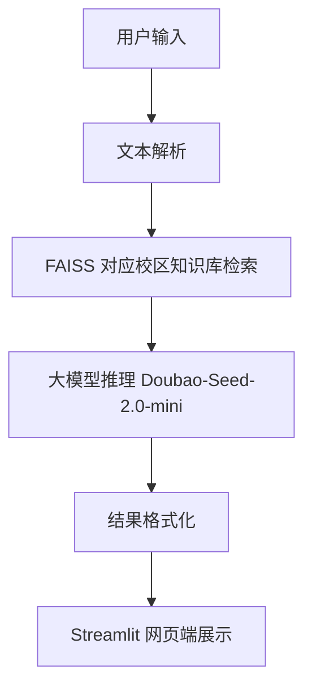

# HIT-CampusAI 哈尔滨工业大学校园 AI 生活助手

[](https://opensource.org/licenses/MIT)
[](https://www.python.org/)
[](https://star-history.com/#HITech-AI/HIT-CampusAI&Date)

为哈尔滨工业大学（本部、深圳、威海）师生做的校园 AI 生活助手。问办事流程、查图书馆借阅规则、看食堂营业时间，一句自然语言提问，先检索对应校区知识库，再由国产大模型组织回答。技术上是 RAG（检索增强生成）：FAISS 召回相关校园知识，大模型生成回复，避免模型凭空编造校园信息。

## 校区支持

当前知识库已落地**哈尔滨工业大学（深圳）**校区，覆盖办事流程、图书馆、食堂、交通等高频场景。项目按"一校三区"方向规划，也面向**哈尔滨工业大学（威海）**等校区扩展：只要有该校区同学参与建设、提供校区资料，就能搭建对应校区的知识库与问答。

欢迎各校区同学参与建设、补充本校区资料。

## 核心功能

- **校园智能问答（核心）**：办事流程、选课/请假/报销、图书馆借阅、食堂与交通等校区高频问题，答案带知识库出处。
- **食堂与商业配套推荐**：按口味偏好与用餐时段推荐食堂窗口。
- **活动提醒**：讲座、招聘会、社团、竞赛按关注领域推送。
- **轻量心理支持**：情绪疏导、压力缓解科普话术（仅辅助，非专业诊疗）。
- **网页端交互**：Streamlit 界面，PC/移动端自适应。

## 技术栈

| 模块 | 选型 |
|---|---|
| 交互层 | Streamlit |
| 文本向量化 | SentenceTransformer `all-MiniLM-L6-v2` |
| 向量检索引擎 | FAISS-CPU |
| 大模型推理 | 字节豆包（火山方舟）`Doubao-Seed-2.0-mini` |
| 请求/配置 | `requests` + `python-dotenv` |
| 开发语言 | Python 3.10+ |

## 架构



数据流向：用户提问 → 向量化 → 在已落地校区知识库文件 `shenzhen_knowledge.txt`（深圳）构建的 FAISS 索引中检索最相关的 3 段知识 → 拼进提示词交给大模型 → 输出带知识库出处的回答。

## 快速开始

```bash
# 1. 克隆仓库
git clone https://github.com/HITech-AI/HIT-CampusAI.git
cd HIT-CampusAI

# 2. 安装依赖
pip install -r requirements.txt

# 3. 配置密钥：在项目根目录新建 .env（参考 .env.example）
#    HIT_AI_API_KEY=你的火山方舟 API 密钥
#    HIT_AI_API_URL=https://ark.cn-beijing.volces.com/api/v3/chat/completions

# 4. 运行（或双击 demo/run_demo.bat）
python src/main.py
```

单独测试大模型接口连通性：

```bash
python src/api/llm_api.py
```

## 目录结构

```
HIT-CampusAI/
├── src/
│   ├── main.py                     # Streamlit 入口
│   ├── api/
│   │   └── llm_api.py              # 火山方舟大模型调用
│   └── knowledge/
│       ├── knowledge_base.py       # 文本向量化 + FAISS 检索
│       └── shenzhen_knowledge.txt  # 已落地校区知识库（深圳）
├── docs/                           # 需求分析 / 技术方案 / 演示脚本 / 截图
├── demo/
│   └── run_demo.bat                # 一键启动脚本
├── requirements.txt
├── .env.example                    # 环境变量模板
└── .gitignore
```

## 扩展知识库

当前知识库文件为 `src/knowledge/shenzhen_knowledge.txt`（深圳校区）。把新的校园信息按 `## 章节标题` 追加进去，重启后自动纳入 FAISS 索引参与检索。要新增威海等校区，新建对应校区知识库文件、按同样格式接入即可。章节越多，问答覆盖越广。

## 路线图与贡献

- 项目现状与阶段规划（含知识库构建策略）：见 [ROADMAP.md](ROADMAP.md)
- 参与贡献 / 补知识库 / 提 PR 流程：见 [CONTRIBUTING.md](CONTRIBUTING.md)

欢迎各校区同学参与建设、补充本校区资料。

## 协议

MIT License，详见 [LICENSE](LICENSE)。
